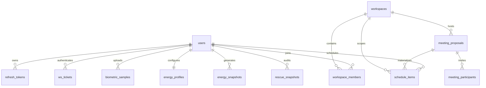

# 01 · 领域模型与 PostgreSQL 数据库设计

> **对应迁移文件**：[0001_init.sql](../services/server/migrations/0001_init.sql)、[0002_ws_tickets.sql](../services/server/migrations/0002_ws_tickets.sql)
> **物理交接契约**：[services/server/internal/engine/contracts.go](../services/server/internal/engine/contracts.go)、[services/server/internal/db/queries/core.sql](../services/server/internal/db/queries/core.sql)  
> **目标**：定义清晰无歧义的领域限界上下文、零 UI 耦合的数据库表结构、时间区间检索机制与多租户隔离边界。

---

## 1. 限界上下文划分（Bounded Contexts）

系统划分为 5 个高内聚领域，各领域之间通过强类型 ID 与明确接口交互，禁止跨表随意修改状态：

1. **Identity & Session（身份与会话）**：管理 `users`、`refresh_tokens` 与 `ws_tickets`，负责账号注册、密码校验、多端令牌轮换与一次性实时连接票据。
2. **Biometrics & Energy（穿戴生理与精力）**：管理 `biometric_samples`、`energy_profiles` 与 `energy_snapshots`，归属个人私有，严禁向团队直接暴露原始样本。
3. **Personal Schedule & Rescue（个人日程与救援）**：管理 `schedule_items` 与 `rescue_snapshots`，统一收纳深度工作、团队会议、恢复缓冲、常规例行与突发任务。
4. **Team Workspace（团队空间与隐私边界）**：管理 `workspaces` 与 `workspace_members`，控制成员身份与对外投影颗粒度（`privacy_level`）。
5. **Collaborative Planner（协同排会引擎）**：管理 `meeting_proposals` 与 `meeting_participants`，负责候选窗口推荐、事务落库与全员日程同步写入。

---

## 2. 实体关系图（ER Diagram）



---

## 3. 全表字段与约束详述

### 3.1 身份与会话：`users` / `refresh_tokens` / `ws_tickets`

| 表名 | 关键字段 | 类型与约束 | 设计意图 |
| --- | --- | --- | --- |
| `users` | `id` | `UUID PK DEFAULT gen_random_uuid()` | 全局唯一用户主键；同时作为并发排会与日程救援的行级互斥锚点 |
| | `email` | `TEXT UNIQUE NOT NULL CHECK (email = lower(btrim(email)))` | 登录账号（入库前统一转小写去空格，DB 层兜底强制小写无首尾空白） |
| | `display_name` | `TEXT NOT NULL` | 展示昵称（1–64 字符） |
| | `password_hash` | `TEXT NOT NULL` | `Argon2id` PHC 字符串格式 |
| | `timezone` | `TEXT NOT NULL DEFAULT 'Asia/Shanghai'` | IANA 时区名，用于解释用户本地工作时段与本地自然日节律起点 |
| | `theme_mode` | `TEXT CHECK IN ('system','light','dark')` | 双端同步外观偏好 |
| | `updated_at` | `TIMESTAMPTZ NOT NULL DEFAULT NOW()` | 由数据库 `BEFORE UPDATE` 触发器 `set_updated_at()` 自动维护（`users`、`energy_profiles`、`workspaces`、`meeting_proposals`、`schedule_items` 均同） |
| `refresh_tokens` | `id`, `user_id` | `UUID PK`, `UUID FK -> users(id) CASCADE` | 会话凭证归属 |
| | `token_hash` | `TEXT UNIQUE NOT NULL` | Refresh Token 原文的 SHA-256 摘要，库内不存明文 |
| | `family_id` | `UUID NOT NULL` | 令牌家族 ID，用于轮换重放盗用检测（若旧令牌被复用则吊销整族） |
| | `device_name` | `TEXT NOT NULL DEFAULT ''` | 标识来源设备（如 `Pixel 8 / Android`、`Chrome / Web`） |
| | `expires_at`, `revoked_at` | `TIMESTAMPTZ` | 过期与主动注销时间戳 |
| `ws_tickets` | `token_hash` | `TEXT PRIMARY KEY` | 30 秒握手票据的 SHA-256 摘要，不保存票据原文；由迁移 `0002_ws_tickets.sql` 引入 |
| | `user_id` | `UUID NOT NULL FK -> users(id) CASCADE` | 票据仅绑定签发时的认证用户 |
| | `expires_at` | `TIMESTAMPTZ NOT NULL` | 配合 `idx_ws_tickets_expiry` 清理过期票据；握手用 `DELETE ... WHERE token_hash = $1 AND expires_at > NOW() RETURNING user_id` 原子消费，共用数据库的多个 API 实例也不能重复消费同一票据 |

### 3.2 穿戴生理与精力：`biometric_samples` / `energy_profiles` / `energy_snapshots`

| 表名 | 关键字段 | 类型与约束 | 设计意图 |
| --- | --- | --- | --- |
| `biometric_samples` | `id`, `user_id` | `UUID PK`, `UUID FK -> users(id) CASCADE` | 生理样本归属 |
| | `source_type` | `CHECK IN ('health_connect','ble_gatt','replay_demo')` | 严格区分真实硬件同步、蓝牙直连与测试回放源 |
| | `metric_type` | `CHECK IN ('heart_rate','hrv_rmssd','resting_hr','sleep_session','sleep_stage','active_calories')` | 标准化指标类型 |
| | `recorded_at`, `end_at` | `TIMESTAMPTZ NOT NULL`, `TIMESTAMPTZ` (`CHECK end_at IS NULL OR end_at >= recorded_at`) | 点指标用 `recorded_at`，睡眠等区间指标同时记录 `end_at` 并校验时间先后 |
| | `numeric_value`, `unit` | `DOUBLE PRECISION NOT NULL`, `TEXT NOT NULL` | 数值与标准单位（`bpm` / `ms` / `minutes` / `kcal`） |
| | `metadata` | `JSONB NOT NULL DEFAULT '{}'::jsonb` | 存设备型号、睡眠分期（`deep`/`rem`/`light`/`awake`）、采样可信度等扩展字段 |
| | `external_id` | `TEXT NOT NULL` | **强制非空确定性幂等键**，与 `(user_id, source_type, metric_type, external_id)` 组成完整唯一索引 `uq_biometrics_external`，彻底杜绝离线队列重试产生重复样本 |
| `energy_profiles` | `user_id` | `UUID PK FK -> users(id) CASCADE` | 每位用户一条精力与节律基线配置 |
| | `work_start_minute` / `work_end_minute` | `INTEGER CHECK [0,1439] / [1,1440]` 且表级约束 `CHECK (work_end_minute > work_start_minute)` | 本地工作日边界（分钟偏移，如 `540` = 09:00，`1110` = 18:30） |
| | `chronotype` | `CHECK IN ('morning_lark','balanced','night_owl')` | 昼夜节律类型，决定冷启动曲线峰值位置 |
| | `preferred_focus_windows` | `JSONB NOT NULL` | 用户自定义心流保护时段数组，例 `[{"startMinute":540,"endMinute":720}]` |
| | `hrv_baseline_ms` / `rhr_baseline_bpm` | `DOUBLE PRECISION` | 近 14 日滑动中位数个人生理基线（定期重算并缓存） |
| | `min_recovery_buffer_min` | `INTEGER DEFAULT 15 CHECK [5,60]` | 连续高负荷后最少预留的恢复缓冲时长 |
| `energy_snapshots` | `local_day` | `DATE NOT NULL` | 用户当前时区下的本地日期（`YYYY-MM-DD`），配合索引 `idx_energy_snapshots_user_day (user_id, local_day, computed_at DESC)` 支持按天极速查询 |
| | `score`, `tier` | `INTEGER [0,100]`, `CHECK IN ('peak','steady','strained','depleted')` | 实时精力分与对应档位 |
| | `data_freshness` | `CHECK IN ('live_wearable','recent_wearable','replay_demo','baseline_only')` | 前端必须据实展示的数据新鲜度与来源标识 |
| | | `hourly_curve`, `drivers` | `JSONB NOT NULL` | 用户本地自然日所有整点带 UTC 时间戳预测曲线（`[{hourStartAt, score, tier}]`，常规 24 点，DST 切换日 23/25 点）及各因子贡献拆解 |
| | `focus_shields` | `JSONB NOT NULL DEFAULT '[]'::jsonb` | 自动识别或推荐的深度专注保护盾时间段列表 |
| | `overload_alert` | `JSONB` | 疲劳过载预警结构（未触发时为 `NULL`） |
| | `diagnostics` | `JSONB NOT NULL DEFAULT '{}'::jsonb` | 穿戴同步与基线诊断元数据（`lastSyncedAt`、`primarySource`、`baselineReadyDays`、`hrvBaselineMs`、`rhrBaselineBpm`） |

### 3.3 团队空间与会议提案：`workspaces` / `workspace_members` / `meeting_proposals` / `meeting_participants`

| 表名 | 关键字段 | 类型与约束 | 设计意图 |
| --- | --- | --- | --- |
| `workspaces` | `id`, `name`, `invite_code`, `owner_id` | `UUID PK`, `TEXT`, `TEXT UNIQUE`, `UUID FK` | 真实团队工作区，通过短邀请码或邀请链接加入 |
| `workspace_members` | `(workspace_id, user_id)` | 复合主键 | 成员身份唯一约束 |
| | `role` | `CHECK IN ('owner','admin','member')` | 管理权限控制 |
| | `privacy_level` | `CHECK IN ('busy_only','energy_tier','full_title')` | **团队隐私防火墙**：<br>• `busy_only`：仅暴露空闲/忙碌<br>• `energy_tier`（默认）：空闲/忙碌 + 精力保护状态（不暴露生理数值与任务标题）<br>• `full_title`：额外展示公开日程标题 |
| `meeting_proposals` | `id`, `workspace_id`, `organizer_id` | `UUID PK`, `UUID FK` | 发起一次团队排会请求 |
| | `duration_minutes`, `cognitive_load` | `INTEGER [15,480]`, `CHECK IN ('high','medium','low')` | 会议时长与认知强度，决定求解器匹配高峰还是平稳时段 |
| | `status` | `CHECK IN ('draft','confirmed','cancelled')` | 提案生命周期；若为 `confirmed` 则强制 `confirmed_start_at` 与 `confirmed_end_at` 非空 |
| | `confirmed_start_at`, `confirmed_end_at` | `TIMESTAMPTZ` (`CHECK confirmed_end_at IS NULL OR confirmed_end_at > confirmed_start_at`) | 确认锁定后的起止时间及合法性约束 |
| | `idempotency_key` | `TEXT` | 与 `(workspace_id, organizer_id, idempotency_key)` 组成唯一部分索引，保障 `Idempotency-Key` 确认重放幂等 |
| | `recommendation_meta` | `JSONB` | 记录采纳窗口的评分明细与推荐理由 |
| `meeting_participants` | `(proposal_id, user_id)` | 复合主键 | 记录必选/可选参会人与接受状态 |

### 3.4 统一日程与救援快照：`schedule_items` / `rescue_snapshots`

| 表名 | 关键字段 | 类型与约束 | 设计意图 |
| --- | --- | --- | --- |
| `schedule_items` | `id`, `user_id` | `UUID PK`, `UUID FK` | 个人全部时间块唯一存储表 |
| | `workspace_id`, `meeting_proposal_id` | `UUID FK ... ON DELETE SET NULL` | 若由团队会议生成，关联来源工作区与提案；受唯一部分索引 `uq_schedule_items_proposal_user (meeting_proposal_id, user_id) WHERE meeting_proposal_id IS NOT NULL` 保护，严防同一提案对同一用户重复落库 |
| | `category` | `CHECK IN ('deep_work','meeting','recovery','routine','urgent')` | 取代旧版割裂的日程/微任务/目标任务三张表 |
| | `cognitive_load` | `CHECK IN ('high','medium','low')` | 任务认知负荷，驱动与精力曲线匹配 |
| | `flexibility` | `CHECK IN ('hard_locked','flexible','focus_shield')` | `hard_locked` 不可移动；`flexible` 允许重排；`focus_shield` 个人深度专注保护块 |
| | `status` | `CHECK IN ('planned','in_progress','completed','cancelled')` | 执行生命周期（严格固定 4 个枚举值） |
| | `start_at`, `end_at` | `TIMESTAMPTZ NOT NULL` (`CHECK end_at > start_at`) | 标准 UTC 起止时间戳 |
| | `duration_minutes` | `INTEGER GENERATED ALWAYS AS (...) STORED NOT NULL` | 数据库自动生成的整型分钟数，零换算误差 |
| | `time_range` | `TSTZRANGE GENERATED ALWAYS AS (tstzrange(start_at, end_at, '[)')) STORED` | 半开区间 `[start, end)`，相邻会议 `10:00-11:00` 与 `11:00-12:00` **不算冲突** |
| `rescue_snapshots` | `local_day` | `DATE NOT NULL` | 救援针对的用户本地日期 |
| | `baseline_version`, `option_hash` | `TEXT NOT NULL`, `TEXT NOT NULL` | 采纳救援时的 48h 日程基线摘要与所选方案确定性哈希，用于乐观锁审计与防篡改追溯 |
| | `idempotency_key` | `TEXT` | 可选请求幂等键（部分唯一索引 `uq_rescue_snapshots_idempotency (user_id, idempotency_key) WHERE idempotency_key IS NOT NULL`） |
| | `strategy` | `CHECK IN ('protect_deadline','protect_recovery','minimize_changes')` | 用户选定的救援权衡策略 |
| | `trigger_reason` | `CHECK IN ('urgent_task','team_meeting_overload','wearable_fatigue')` | 强约束枚举：记录触发重排的根因 |
| | `before_items`, `after_items` | `JSONB NOT NULL` | 救援前后相关日程完整快照，用于原子撤销与复盘审计 |
| | `status` | `CHECK IN ('applied','reverted')` | 防止同一快照被重复撤销 |

---

## 4. 关键查询与索引设计

### 4.1 亚毫秒级时间碰撞检索（GiST 区间索引）
- `idx_schedule_items_user_range` 基于 `GIST (user_id, time_range) WHERE status <> 'cancelled'`：
  - 判断单个或多个用户某时段是否与不可移动日程冲突：
    ```sql
    SELECT id, user_id, title, category, flexibility, start_at, end_at
    FROM schedule_items
    WHERE user_id = ANY($1::uuid[])
      AND status <> 'cancelled'
      AND (flexibility = 'hard_locked' OR category = 'meeting')
      AND time_range && tstzrange($2, $3, '[)');
    ```
  - 批量查询团队成员在某日窗内的有效日程块（用于协同排会投影）：
    ```sql
    SELECT id, user_id, start_at, end_at, category, cognitive_load, flexibility, status, title
    FROM schedule_items
    WHERE user_id = ANY($1::uuid[])
      AND status <> 'cancelled'
      AND time_range && tstzrange($2, $3, '[)')
    ORDER BY user_id, start_at;
    ```
- 其他核心索引：
  - `uq_biometrics_external`：`(user_id, source_type, metric_type, external_id)` 非部分唯一索引，支撑 `ON CONFLICT DO NOTHING` 批量幂等写入。
  - `idx_energy_snapshots_user_day`：`(user_id, local_day, computed_at DESC)`，支撑 `GET /api/v1/energy/today?day=YYYY-MM-DD` 瞬时命中。
  - `uq_schedule_items_proposal_user`：`(meeting_proposal_id, user_id) WHERE meeting_proposal_id IS NOT NULL`，防止并发重试下同一提案为同一参会者生成多条日程。
  - `idx_ws_tickets_expiry`：`(expires_at)`，支持签发新票据时删除已过期票据；数据库只持有短效票据摘要。

### 4.2 事务一致性规则

#### 4.2.1 团队会议确认事务（防“空日历幻读”与“交叉死锁”）
当 `meeting_proposals` 从 `draft -> confirmed`（或直接确认落库）时，若仅对 `schedule_items` 执行 `SELECT ... FOR UPDATE`，当某参会人当天原本是**空日历（0 条记录）**时，PostgreSQL 无法锁住不存在的行，两个并发排会请求将同时通过冲突检查并插入重叠会议（幻读）；若按前端传入顺序逐个锁表，又可能引发多事务交叉死锁。

**强制标准事务步骤**：
1. 开启数据库事务（`BEGIN`）。
2. 将本次会议全部参会人 `user_id` 去重并在应用层（或 SQL 层）按 UUID 字典序升序排列，执行用户主表行锁：
   ```sql
   SELECT id FROM users
   WHERE id = ANY($1::uuid[])
   ORDER BY id
   FOR UPDATE;
   ```
   - **消除空日历幻读**：每个参会人在 `users` 表中必有一行真实记录，即使其当天 0 条日程，并发确认事务也会在该用户的 `users` 行锁上严格串行化。
   - **消除交叉死锁**：全局统一按 `ORDER BY id` 升序加锁，彻底切断循环等待条件。
3. 执行 GiST 区间重叠查询 `time_range && tstzrange($2, $3, '[)')`，校验所有必选参会者在此窗口内是否存在 `status <> 'cancelled'` 且（`flexibility = 'hard_locked'` 或 `category = 'meeting'`）的冲突项。
   - 若存在冲突，立即 `ROLLBACK` 并返回 `409 CONFLICT_MEMBER_BUSY` 及冲突成员详情。
4. 更新或插入 `meeting_proposals (status = 'confirmed', confirmed_start_at = $2, confirmed_end_at = $3)`，为必选成员和当前无硬冲突的可选成员写入 `schedule_items`（受 `uq_schedule_items_proposal_user` 保护），提交事务（`COMMIT`）。忙碌的可选成员仍保留邀请，可在冲突释放后接受；同一成员同时出现在必选和可选列表时以必选为准。`createdScheduleCount` 及幂等重试响应均统计实际已落库的日程行，不能直接使用邀请人数。
5. 事务提交后，异步触发参会人当天 `energy_snapshots` 重算与 WebSocket `workspace.meeting_confirmed` 广播。

#### 4.2.2 救援乐观锁口径与撤销冲突检测规则
1. **`baselineVersion` 确定性计算口径**：
   - 给定用户本地日期 `day`（`YYYY-MM-DD`）及其所在时区换算的当日零点 `dayStartUTC`，查询时间窗覆盖 **`[dayStartUTC, dayStartUTC + 48h)`**（同时涵盖当日及次日顺延窗口）内该用户所有 `status <> 'cancelled'` 的 `schedule_items`（即 `time_range && tstzrange(dayStartUTC, dayStartUTC + interval '48 hours', '[)')`）。
   - 若窗口内无任何记录，则 `baselineVersion = "empty:" + day`（例如 `"empty:2026-11-18"`）。
   - 若有记录，按 `id` 字典序升序排序后，逐条以固定格式拼接 `(id, start_at_utc_rfc3339_nano, end_at_utc_rfc3339_nano, status, flexibility, updated_at_utc_rfc3339_nano)`，计算 SHA-256 并取前 16 位小写十六进制字符串（16-char hex）。
2. **`apply` 采纳事务规则**：
   - 开启事务后先执行 `SELECT id FROM users WHERE id = $1 FOR UPDATE;` 锁住当前用户行。
   - 重新拉取 `[dayStartUTC, dayStartUTC + 48h)` 内的有效日程并计算当前 `currentBaselineVersion`：若与请求携带的 `baselineVersion` 不一致（例如期间刚有新团队会议确认落库），立即回滚并返回 `409 STALE_BASELINE_VERSION`。
   - 调用纯函数引擎重新求解对应 `strategy` 的方案（若请求携带 `expectedOptionHash` 则一并比对 `optionHash`），在单事务内写入 `schedule_items` 变更与 `rescue_snapshots (status = 'applied', local_day, baseline_version, option_hash, before_items, after_items)`。
3. **`undo` 撤销冲突检测规则**：
   - 开启事务后首先锁住该用户主表行：`SELECT id FROM users WHERE id = $1 FOR UPDATE;`，并锁定目标快照行 `SELECT * FROM rescue_snapshots WHERE id = $2 AND user_id = $1 FOR UPDATE;`。
   - 校验快照 `status`：若已为 `'reverted'`，回滚并返回 `409 ALREADY_REVERTED`。
   - **还原时间窗冲突校验**：提取 `before_items` 中每条待还原日程的原始时间区间 `[start_at, end_at)`，在数据库中检查该用户在相应时段内是否存在**快照应用之后新产生**（即不属于本次快照 `after_items` 集合）且 `status <> 'cancelled'` 的 `hard_locked` 或 `category = 'meeting'` 日程重叠。
   - 若存在冲突，严禁强行覆盖新确认的会议或硬锁定日程，立即回滚并返回 `409 SNAPSHOT_RESTORE_CONFLICT`（附带冲突日程详情）；若无冲突，则按 `before_items` 原子还原 `schedule_items`（并将快照新增的紧急任务标记为 `cancelled` 或回退），同时更新 `rescue_snapshots` 为 `status = 'reverted', reverted_at = NOW()`。
