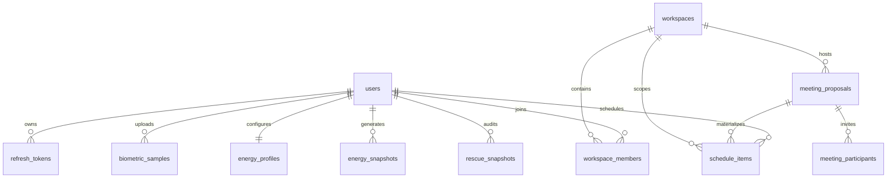

# 01 · 领域模型与 PostgreSQL 数据库设计

> **对应迁移文件**：[services/server/migrations/0001_init.sql](../services/server/migrations/0001_init.sql)
> **目标**：定义清晰无歧义的领域限界上下文、零 UI 耦合的数据库表结构、时间区间检索机制与多租户隔离边界。

---

## 1. 限界上下文划分（Bounded Contexts）

系统划分为 5 个高内聚领域，各领域之间通过强类型 ID 与明确接口交互，禁止跨表随意修改状态：

1. **Identity & Session（身份与会话）**：管理 `users` 与 `refresh_tokens`，负责账号注册、密码校验与多端令牌轮换。
2. **Biometrics & Energy（穿戴生理与精力）**：管理 `biometric_samples`、`energy_profiles` 与 `energy_snapshots`，归属个人私有，严禁向团队直接暴露原始样本。
3. **Personal Schedule & Rescue（个人日程与救援）**：管理 `schedule_items` 与 `rescue_snapshots`，统一收纳深度工作、团队会议、恢复缓冲、常规例行与突发任务。
4. **Team Workspace（团队空间与隐私边界）**：管理 `workspaces` 与 `workspace_members`，控制成员身份与对外投影颗粒度（`privacy_level`）。
5. **Collaborative Planner（协同排会引擎）**：管理 `meeting_proposals` 与 `meeting_participants`，负责候选窗口推荐、事务落库与全员日程同步写入。

---

## 2. 实体关系图（ER Diagram）



---

## 3. 全表字段与约束详述

### 3.1 身份与会话：`users` / `refresh_tokens`

| 表名 | 关键字段 | 类型与约束 | 设计意图 |
| --- | --- | --- | --- |
| `users` | `id` | `UUID PK DEFAULT gen_random_uuid()` | 全局唯一用户主键 |
| | `email` | `TEXT UNIQUE NOT NULL` | 登录账号（入库前统一转小写去空格） |
| | `display_name` | `TEXT NOT NULL` | 展示昵称（1–64 字符） |
| | `password_hash` | `TEXT NOT NULL` | `Argon2id` PHC 字符串格式 |
| | `timezone` | `TEXT NOT NULL DEFAULT 'Asia/Shanghai'` | IANA 时区名，用于解释用户本地工作时段与 24h 节律起点 |
| | `theme_mode` | `TEXT CHECK IN ('system','light','dark')` | 双端同步外观偏好 |
| `refresh_tokens` | `id`, `user_id` | `UUID PK`, `UUID FK -> users(id) CASCADE` | 会话凭证归属 |
| | `token_hash` | `TEXT UNIQUE NOT NULL` | Refresh Token 原文的 SHA-256 摘要，库内不存明文 |
| | `family_id` | `UUID NOT NULL` | 令牌家族 ID，用于轮换重放盗用检测（若旧令牌被复用则吊销整族） |
| | `device_name` | `TEXT NOT NULL DEFAULT ''` | 标识来源设备（如 `Pixel 8 / Android`、`Chrome / Web`） |
| | `expires_at`, `revoked_at` | `TIMESTAMPTZ` | 过期与主动注销时间戳 |

### 3.2 穿戴生理与精力：`biometric_samples` / `energy_profiles` / `energy_snapshots`

| 表名 | 关键字段 | 类型与约束 | 设计意图 |
| --- | --- | --- | --- |
| `biometric_samples` | `id`, `user_id` | `UUID PK`, `UUID FK -> users(id) CASCADE` | 生理样本归属 |
| | `source_type` | `CHECK IN ('health_connect','ble_gatt','replay_demo')` | 严格区分真实硬件同步、蓝牙直连与测试回放源 |
| | `metric_type` | `CHECK IN ('heart_rate','hrv_rmssd','resting_hr','sleep_session','sleep_stage','active_calories')` | 标准化指标类型 |
| | `recorded_at`, `end_at` | `TIMESTAMPTZ NOT NULL`, `TIMESTAMPTZ` | 点指标用 `recorded_at`，睡眠等区间指标同时记录 `end_at` |
| | `numeric_value`, `unit` | `DOUBLE PRECISION`, `TEXT` | 数值与标准单位（`bpm` / `ms` / `minutes` / `kcal`） |
| | `metadata` | `JSONB NOT NULL DEFAULT '{}'` | 存设备型号、睡眠分期（`deep`/`rem`/`light`/`awake`）、采样可信度等扩展字段 |
| | `external_id` | `TEXT` | 与 `(user_id, source_type, metric_type, external_id)` 组成唯一部分索引，保障离线重试幂等去重 |
| `energy_profiles` | `user_id` | `UUID PK FK -> users(id) CASCADE` | 每位用户一条精力与节律基线配置 |
| | `work_start_minute` / `work_end_minute` | `INTEGER CHECK [0,1439] / [1,1440]` | 本地工作日边界（分钟偏移，如 `540` = 09:00，`1110` = 18:30） |
| | `chronotype` | `CHECK IN ('morning_lark','balanced','night_owl')` | 昼夜节律类型，决定冷启动曲线峰值位置 |
| | `preferred_focus_windows` | `JSONB` | 用户自定义心流保护时段数组，例 `[{"startMinute":540,"endMinute":720}]` |
| | `hrv_baseline_ms` / `rhr_baseline_bpm` | `DOUBLE PRECISION` | 近 14 日滑动中位数个人生理基线（定期重算并缓存） |
| | `min_recovery_buffer_min` | `INTEGER DEFAULT 15 CHECK [5,60]` | 连续高负荷后最少预留的恢复缓冲时长 |
| `energy_snapshots` | `score`, `tier` | `INTEGER [0,100]`, `CHECK IN ('peak','steady','strained','depleted')` | 实时精力分与对应档位 |
| | `data_freshness` | `CHECK IN ('live_wearable','recent_wearable','replay_demo','baseline_only')` | 前端必须据实展示的数据新鲜度与来源标识 |
| | `hourly_curve`, `drivers` | `JSONB` | 24h 逐小时预测曲线及各因子贡献拆解 |

### 3.3 团队空间与会议提案：`workspaces` / `workspace_members` / `meeting_proposals` / `meeting_participants`

| 表名 | 关键字段 | 类型与约束 | 设计意图 |
| --- | --- | --- | --- |
| `workspaces` | `id`, `name`, `invite_code`, `owner_id` | `UUID PK`, `TEXT`, `TEXT UNIQUE`, `UUID FK` | 真实团队工作区，通过短邀请码或邀请链接加入 |
| `workspace_members` | `(workspace_id, user_id)` | 复合主键 | 成员身份唯一约束 |
| | `role` | `CHECK IN ('owner','admin','member')` | 管理权限控制 |
| | `privacy_level` | `CHECK IN ('busy_only','energy_tier','full_title')` | **团队隐私防火墙**：<br>• `busy_only`：仅暴露空闲/忙碌<br>• `energy_tier`（默认）：空闲/忙碌 + 精力保护状态（不暴露生理数值与任务标题）<br>• `full_title`：额外展示公开日程标题 |
| `meeting_proposals` | `id`, `workspace_id`, `organizer_id` | `UUID PK`, `UUID FK` | 发起一次团队排会请求 |
| | `duration_minutes`, `cognitive_load` | `INTEGER [15,480]`, `CHECK IN ('high','medium','low')` | 会议时长与认知强度，决定求解器匹配高峰还是平稳时段 |
| | `status` | `CHECK IN ('draft','confirmed','cancelled')` | 提案生命周期 |
| | `confirmed_start_at`, `confirmed_end_at` | `TIMESTAMPTZ` | 确认锁定后的起止时间 |
| | `recommendation_meta` | `JSONB` | 记录采纳窗口的评分明细与推荐理由 |
| `meeting_participants` | `(proposal_id, user_id)` | 复合主键 | 记录必选/可选参会人与接受状态 |

### 3.4 统一日程与救援快照：`schedule_items` / `rescue_snapshots`

| 表名 | 关键字段 | 类型与约束 | 设计意图 |
| --- | --- | --- | --- |
| `schedule_items` | `id`, `user_id` | `UUID PK`, `UUID FK` | 个人全部时间块唯一存储表 |
| | `workspace_id`, `meeting_proposal_id` | `UUID FK ... ON DELETE SET NULL` | 若由团队会议生成，关联来源工作区与提案 |
| | `category` | `CHECK IN ('deep_work','meeting','recovery','routine','urgent')` | 取代旧版割裂的日程/微任务/目标任务三张表 |
| | `cognitive_load` | `CHECK IN ('high','medium','low')` | 任务认知负荷，驱动与精力曲线匹配 |
| | `flexibility` | `CHECK IN ('hard_locked','flexible','focus_shield')` | `hard_locked` 不可移动；`flexible` 允许重排；`focus_shield` 个人深度专注保护块 |
| | `status` | `CHECK IN ('planned','in_progress','completed','cancelled')` | 执行生命周期 |
| | `start_at`, `end_at` | `TIMESTAMPTZ NOT NULL` (`CHECK end_at > start_at`) | 标准 UTC 起止时间戳 |
| | `duration_minutes` | `INTEGER GENERATED ALWAYS AS (...) STORED` | 数据库自动生成的整型分钟数，零换算误差 |
| | `time_range` | `TSTZRANGE GENERATED ALWAYS AS (tstzrange(start_at, end_at, '[)')) STORED` | 半开区间 `[start, end)`，相邻会议 `10:00-11:00` 与 `11:00-12:00` **不算冲突** |
| `rescue_snapshots` | `strategy`, `trigger_reason` | `TEXT CHECK`, `TEXT` | 记录 `urgent_task` / `team_meeting_overload` / `wearable_fatigue` 触发的重排 |
| | `before_items`, `after_items` | `JSONB NOT NULL` | 救援前后相关日程完整快照，用于原子撤销与复盘审计 |
| | `status` | `CHECK IN ('applied','reverted')` | 防止同一快照被重复撤销 |

---

## 4. 关键查询与索引设计

### 4.1 亚毫秒级时间碰撞检索（GiST 区间索引）
`idx_schedule_items_user_range` 基于 `GIST (user_id, time_range) WHERE status <> 'cancelled'`：
- 判断单个用户某时段是否冲突：
  ```sql
  SELECT id, title, flexibility, start_at, end_at
  FROM schedule_items
  WHERE user_id = $1
    AND status <> 'cancelled'
    AND time_range && tstzrange($2, $3, '[)');
  ```
- 批量查询团队成员在某日窗内的忙碌块（用于协同排会投影）：
  ```sql
  SELECT user_id, start_at, end_at, category, flexibility, title
  FROM schedule_items
  WHERE user_id = ANY($1::uuid[])
    AND status <> 'cancelled'
    AND time_range && tstzrange($2, $3, '[)')
  ORDER BY user_id, start_at;
  ```

### 4.2 事务一致性规则
1. **团队会议确认事务**：`meeting_proposals` 从 `draft -> confirmed` 时，在同一数据库事务中锁定参与成员当天的 `schedule_items`（`SELECT ... FOR UPDATE` 或串行化/咨询锁 `pg_advisory_xact_lock`），二次校验与 `hard_locked` / 已确认 `meeting` 无新产生的重叠；若在此毫秒级窗口内被别人抢占，返回 `409 Conflict` 并附带冲突成员提示，不写入残缺日程。
2. **救援采纳与撤销事务**：`rescue_snapshots` 插入 `applied` 与更新 `schedule_items` 必须在单事务内提交；撤销时检查 `status = 'applied'`，用 `before_items` 还原对应条目并标记 `status = 'reverted', reverted_at = NOW()`，禁止重复撤销。
