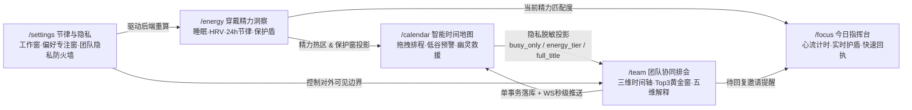
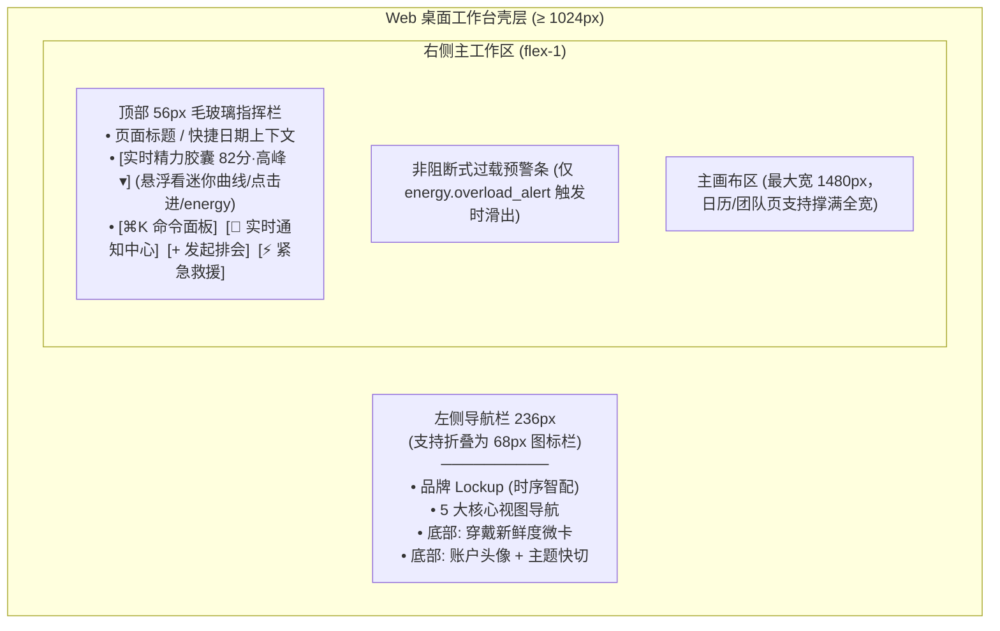
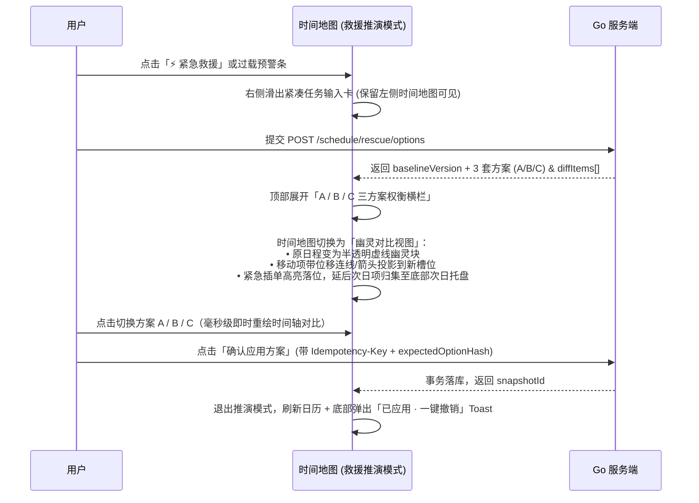

# 时序智配 Web 工作台前端大幅优化与重构设计方案

> **目标读者**：项目负责人评审 & **Hydrogen** 具体编码实现规范\
> **适用目录**：`apps/web`\
> **状态**：已定稿（已确认核心架构决策，可直接进入 Phase 0 实施）\
> **设计基线**：严格对齐 [README.md](../../README.md)、[AGENT.md](../../AGENT.md) 八条工程红线及现有 **32 个 REST API + 7 类 WebSocket 事件**（[openapi.json](../../contracts/openapi.json)），**零后端契约破坏、零虚假数据、零前端私自算分**。

---

## 一、现状深度诊断：为什么当前 Web 前端需要大幅重构？

通过逐文件审计 `apps/web/src/`，当前前端虽然在工程底座（`openapi-fetch`、TanStack Query、WebSocket、时区工具、测试覆盖）上打下了非常扎实的基础，但在**产品聚焦度、桌面工作台交互深度、后端能力利用率与视觉工程**上存在 5 个结构性问题：

| 维度 | 当前代码中的核心痛点（附源码证据） | 对产品定位的伤害 |
| --- | --- | --- |
| **1. 导航失焦，核心卖点被边缘化** | [workbench-shell.tsx](../../apps/web/src/components/shell/workbench-shell.tsx) 左侧栏堆了 8 个一级入口，`features/legacy/*`（微任务、目标、智能复盘、接入诊断）占去半壁江山，而本项目最大差异化卖点 **`/energy`（穿戴精力洞察）竟然从主导航中彻底消失**；顶栏也删掉了实时精力胶囊与桌面快捷排会/救援按钮。 | 评审者与真实用户打开后，第一眼看到的是一个“平庸的本地待办+旧版诊断杂烩”，核心闭环（生理感知 → 精力保护 → 隐私排会）被严重稀释。 |
| **2. “防御性灰置控件”泛滥** | 为兼顾旧版页面结构与数据诚实性，[profile-page.tsx](../../apps/web/src/features/settings/profile-page.tsx)、[preferences-drawer.tsx](../../apps/web/src/features/settings/preferences-drawer.tsx)、[auth-page.tsx](../../apps/web/src/features/auth/auth-page.tsx) 与 `legacy/*` 充斥大量 `disabled` 开关、灰置滑块、“尚未接入”提示框与空态占位（`/profile` 超过 60% 区域不可交互）。 | 数据诚实不等于展示半成品壳子。满屏灰置控件和免责声明会强烈传递“系统未完工”的负面观感。 |
| **3. 后端高价值字段被大量闲置** | Go 服务端已算好并返回的黄金数据，前端完全没展示： • 排会推荐 `GoldenWindowRecommendation` 的 **`breakdown` 五维评分** 与 **`affectedMembers` 逐人影响** 未渲染，且 `explanationTags[].tone` 未做语义着色； • 团队可用性 `MemberAvailabilityView` 的 **`energyBuckets[]`** 与 **`workStartMinute–workEndMinute`** 未投影到 [team-time-map.tsx](../../apps/web/src/features/team/team-time-map.tsx)； • 精力接口支持按 `?day=` 查询，但 [energy-page.tsx](../../apps/web/src/features/energy/energy-page.tsx) 写死今日。 | 后端算法引擎最具技术壁垒的“可解释性”在界面上几乎隐形。 |
| **4. 桌面主力画布交互与空间效率偏低** | • [calendar-page.tsx](../../apps/web/src/features/calendar/calendar-page.tsx) 顶部叠加 4 层控制条（占去 ~300px 垂直空间），右侧常驻静态救援文案挤占网格宽度； • [time-map.tsx](../../apps/web/src/features/calendar/time-map.tsx) 缺少拖拽移动/缩放/拖选新建，也缺少高负荷排入精力低谷的温和提醒； • [rescue-panel.tsx](../../apps/web/src/features/calendar/rescue-panel.tsx) 仅以纯文字列表展示 A/B/C 方案，无法在时间轴上直观看到重排前后对比。 | Web 端的定位是“大屏主力操作台”，当前体验仍停留在“表单驱动的静态展示页”。 |
| **5. CSS 层叠债与组件可读性债** | Tailwind CSS v4 已安装却极少使用；样式由 `tokens.css` → `workbench.css` → `shell.css` → 模块 CSS → [reference.css](../../apps/web/src/styles/reference.css) 多层覆盖，断点互相打架（`1101/780px` vs `1024/779px`）；混用 `Material Symbols` 字体与 `lucide-react` 两套图标；大量 `.tsx` 压缩为极长的单行 JSX，且正文字号低至 `10px–12px`。 | 后续迭代成本高、视觉一致性弱、大屏与高分屏阅读偏累。 |

---

## 二、重构总体目标与信息架构（IA Redesign）

### 2.1 产品核心叙事回归

将 Web 工作台重新锚定为 **“懂你身体节律的个人精力护盾 × 不打扰深度的团队协同排会中枢”**，所有页面和交互严格服务于一条高密闭环：

### 2.2 导航与路由收敛方案（8 页冗杂 → 5 核心视图 + 零灰置死页）

严格落实 [设计系统文档](../06-design-system-v2.md) 与 [AGENT.md](../../AGENT.md) 红线 1：

| 导航位次 | 路由 | 中文名称 | 核心角色定位 | 移动端 Bottom Nav |
| --- | --- | --- | --- | --- |
| 1 | `/focus` | **今日专注** | 每日启动驾驶舱：当前任务-精力匹配、沉浸心流计时、待回复会议快报、一键触发救援 | 专注 |
| 2 | `/calendar` | **时间地图** | 桌面绝对主力画布：日/周/月/甘特、精力热区叠层、拖拽编辑、**幽灵时间轴三方案救援** | 日历 |
| 3 | `/team` | **团队排会** | 多人隐私脱敏矩阵（工作窗+精力带+占用块）、分屏黄金窗口求解、五维评分拆解、会议回执 | 团队 |
| 4 | `/energy` | **精力洞察** | 穿戴生理仪表盘：5 因子归因瀑布图、24h 曲线与日程叠加、测试回放演练、14 日基线诊断 | 精力 |
| 5 | `/settings` | **节律与隐私** | 4-Tab 统一控制台：个人工作节律、团队隐私防火墙（含他人视角预览）、账户外观、连接诊断 | 设置 |

### 2.3 全新全局壳层（AppShell v2.5）

1. **实时精力动态胶囊（Energy Pill）**：常驻顶栏，直接读取 `useEnergy(today)`，展示 `分数 + 档位色点 + 来源标识`；点击展开迷你浮层（展示当前小时预测、下一个高峰/低谷、数据同步时间、快捷跳转 `/energy` 或切换回放场景）。
2. **真实可用的“实时通知中心”（替代原 disabled 按钮）**：在前端内存中维护本次会话的 WebSocket 实时事件流（`energy.updated`、`energy.overload_alert`、`workspace.meeting_confirmed/cancelled/responded`、`schedule.updated`）+ 聚合当前所有 **`responseStatus === 'pending'` 的团队会议邀请**，打开 Popover 即可直接点击“接受 / 拒绝”或跳转对应日程，彻底告别“系统通知（预留）”死按钮。
3. **全局命令面板（`⌘K / Ctrl+K`）**：支持键盘快速跳转 5 大视图、新建日程、触发紧急救援、发起协同排会、切换浅/深色主题、触发测试回放场景。

---

## 三、视觉语言与前端工程系统升级（Design System v2.5）

### 3.1 视觉气质定位：“精密生理时序仪器 × 温润刊物秩序”

完整承接并拔高 [设计系统文档](../06-design-system-v2.md) 的深松绿 + 瓷白基因，彻底摆脱当前“灰白表格 + 蚂蚁字 + 到处是免责盒”的廉价后台感：

- **色彩体系扩展（浅/深双模对齐）**：
  - 保留品牌主色 `深松绿 #002727 / #163d3d`、画布 `瓷白 #faf8fe` / `深松夜 #0e1718`、行动主色 `动力蓝 #005db5`。
  - **新增“精力四档”专属语义令牌**（同步应用于日历热区、24h 曲线、团队脱敏轨道与精力胶囊）：
    - `Peak (高峰 80–100)`：浅色 `#0d7a5f` / 底色 `#e4f6ef`；深色 `#4ade9c` / 底色 `#0f2e25`
    - `Steady (平稳 55–79)`：浅色 `#1e6f8c` / 底色 `#e6f3f8`；深色 `#67c3e6` / 底色 `#122933`
    - `Strained (疲惫 35–54)`：浅色 `#b4690e` / 底色 `#fef3e2`；深色 `#f5b856` / 底色 `#302411`
    - `Depleted (耗竭 0–34)`：浅色 `#ba1a1a` / 底色 `#ffebe9`；深色 `#ff968a` / 底色 `#361918`
- **排版与字号纠偏**：
  - 正文字号从当前 `10px–12px` 全面提升至 **`13px–14px`**（辅助说明不低于 `12px`，微标签不低于 `11px`），行高 `1.5–1.6`，确保桌面端长时间阅读舒适无压迫感。
  - 页面主标题、精力得分大数字、计时器、黄金窗口总分使用 `Noto Serif SC` + `tabular-nums`，形成高级刊物级的数字锚点。
- **零灰置诚实原则（Zero-Apology Honesty）**：
  - 界面上出现的每一个按钮、滑块、开关都必须 **100% 真实有效**；后端不提供的能力（如跨日专注趋势、外部 OAuth 同步、番茄钟云端设置、系统应用拦截、重复日程规则、游客登录）**直接移除控件，而不是渲染一堆 `disabled` 假控件再附带长段免责说明**。
  - 数据诚实通过 **精致的语义徽标（Source Pill）** 表达：`穿戴实时`（绿点）、`最近同步`（青点）、`回放演练`（紫/蓝实验徽标）、`基线推演`（灰蓝波纹标），点击或悬浮可看完整解释。

### 3.2 CSS 与组件工程清债

1. **废除 `reference.css` 补丁层与多重断点打架**：统一为唯一响应式断点阶梯：`mobile (< 768px)`、`tablet (768px–1023px)`、`desktop (1024px–1399px)`、`wide (≥ 1400px)`。
2. **彻底启用 Tailwind CSS v4 + `@theme inline`**：`tokens.css` 专注定义 CSS 变量与 `@theme` 映射，页面与组件布局、间距、排版全面采用清晰的 Tailwind v4 工具类 + `cva` 组件变体，仅保留时间轴网格与动画的极少量模块 CSS。
3. **统一图标体系为 `lucide-react`**：移除 `Material Symbols Outlined` 字体文件与 `Symbol` 混用，减少首屏字体体积并保证线条粗细完全一致（统一 `strokeWidth={1.75}`）。
4. **重写压缩式 TSX，建立干净组件分层**：将当前单行压缩 JSX 重构为可读、可测、职责单一的标准 React 组件，并补充统一的基础 UI 原语（`Tabs`、`Popover`、`Toast`、`Tooltip`、`Badge`、`Select`、`CommandPalette`）。

---

## 四、五大核心视图深度重构设计

### 视图 1：`/calendar` 智能时间地图与“幽灵时间轴”救援工作台（最核心升级）

#### 1. 空间重构：从“四层压顶 + 窄网格”到“单行指挥栏 + 全宽沉浸画布”
- **顶部工具栏压缩为单行 56px**：
  - 左：`< 今天 >` + 当前日期/周次标题 + 紧凑日期跳转按钮（点击弹出月历 Popover）。
  - 中：Segmented 视图切换 `日 | 周 | 月 | 甘特`。
  - 右：`[精力叠层开关]`、`[显示筛选 Popover]`（收纳所有勾选滤镜）、`[导入]`、`[+ 新增日程]`、醒目琥珀/红描边按钮 **`[⚡ 紧急救援]`**。
- **右侧栏默认收起（Collapsible Context Rail）**：画布默认享 **100% 主区宽度**；点击右上角“日程健康与快照”按钮可展开 320px 侧栏，展示：
  - 今日认知负荷分布（高/中/低负荷分钟数 vs 精力电量）
  - 最近的救援快照列表（直接展示策略、影响项数，**支持一键撤销 `POST /schedule/rescue/undo`**）。

#### 2. 时间地图（TimeMap）直接操纵与生理智能叠层
- **三大桌面级直接操纵**（全部遵循物理时间 RFC 3339 持久化，绝不用像素反算保存误差，以 15 分钟刻度吸附）：
  1. **框选新建（Drag-to-Create）**：在日/周视图空白槽位按住上下拖出时间区间，实时显示起止时间与时长标签，松手直接打开预填好起止时间的 `ScheduleEditor`。
  2. **拖拽改期（Drag-to-Move）**：对非团队会议（`!item.meetingProposalId`）的个人日程支持拖拽平移至同日或跨日时间槽；松手调用 `PATCH /schedule/items/{id}`。若触发 `409 CONFLICT_SCHEDULE_OVERLAP`，回弹并弹出轻量确认框询问是否“强制重叠保存（`allowOverlap: true`）”。
  3. **底边拉伸改时长（Resize Handle）**：悬停日程块底部显示拖拽条，拉动即时调整 `endAt`。
- **精力热区叠层 + 保护盾可视化**：
  - 时间轴左侧（或日列背景最左侧）渲染柔和渐变 **24h 精力色带**，并在背景中以极浅的语义底纹区分高峰/平稳/低谷区；鼠标悬停整点时在侧边标尺浮现精确气泡（`14:00 · 预测精力 46 分 · 疲惫区`）。
  - `focusShields` 以带盾牌微标的**深松绿虚线保护框**呈现，鼠标悬停标注“深度专注保护窗 · 均值 85 分”。
- **低谷排高负荷温和预警（非阻断）**：
  - 在 `ScheduleEditor` 选择时间与 `cognitiveLoad === 'high'` 时，前端比对已加载的 `energy.hourlyCurve`（仅查表展示，不算分）：若落入 `strained` 或 `depleted` 时段，表单内温和提示：“该时段预测精力较低（42 分），建议改至今日高峰窗口 `09:30–11:00`”，并提供**一键采纳该建议时段**按钮。

#### 3. 标志性创新：可视化“幽灵时间轴”救援推演模式（Visual Rescue Staging）
彻底取代当前“在窄抽屉里看纯文本 `09:00 → 14:00`”的割裂体验：

- 若落库时遇 `409 STALE_BASELINE_VERSION`，横栏自动高亮提示“日程刚刚被其他端修改”，一键重拉 `/rescue/options` 刷新最新对比，无需重填表单。

---

### 视图 2：`/team` 团队协同排会与隐私矩阵工作台（第二核心升级）

#### 1. 顶部工作区切换与“待我回复”高优行动条
- 将臃肿的 Header 收敛为清晰的工作区顶栏：自定义下拉切换工作区 + 成员数徽标 + 当前隐私级别徽标（点击快捷修改 `PATCH /workspaces/{id}/me`）+ `邀请成员` + `创建/加入` + 主 CTA **`发起智能排会`**。
- 若存在当前用户 `responseStatus === 'pending'` 的会议，顶部高亮呈现 **“待确认会议邀请”行动条**，无需向下滚动即可一键 `接受` / `拒绝`。

#### 2. 全面升级 `TeamTimeMap`：三维脱敏时间轴矩阵
充分消费 `GET /workspaces/{id}/availability` 已返回但目前被浪费的全部字段：
1. **跨时区工作时段底纹**：用浅色/深色对比底纹标出每位成员的 `workStartMinute–workEndMinute`（全部投影到当前用户本地时区），跨时区团队的**共同工作交集**肉眼立现。
2. **底层脱敏精力色带（严格零生理数值泄露）**：当成员 `privacyLevel !== 'busy_only'` 且返回了 `energyBuckets[]` 时，在其轨道底层以柔和透明色块渲染逐小时 `peak / steady / strained / depleted` 状态带（图例明确标注“仅精力档位，不含分数与生理指标”）；`busy_only` 成员轨道则保持纯净中性底色并带隐私锁图标。
3. **占用块状态分级**：`busy`（中性深灰锁）、`focus_shield`（深松绿盾牌斜纹，视觉强调“请勿打扰”）、`soft_busy`（浅蓝虚线可协商）。
4. **黄金窗口直接叠加投影**：当排会求解返回 Top 3 候选窗口后，选中任意候选窗口，**时间轴上立即出现一条贯通全员行的深松绿发光竖带**（可联动切日），直观展示这个窗口如何优雅地落入全员工作交集、对齐高峰精力、且完美避开每个人的心流保护盾！

#### 3. 分屏排会向导 + 全字段可解释黄金窗口卡片
- **桌面端采用分屏/联动抽屉布局**（排会结果与时间轴同屏联动），并在每张 Top 1 / 2 / 3 推荐卡中**完整激活后端返回的全部可解释性数据**：
  - **综合匹配分 + 五维评分条（`ScoreBreakdown`）**：
    - 精力匹配 `energyMatchScore`
    - 心流保护 `focusShieldScore`
    - 碎片紧凑度 `compactnessScore`
    - 尽早安排 `earlinessScore`
    - 可选成员参会率 `optionalAttendanceRatio`（百分比呈现）
  - **语义着色解释标签（`explanationTags`）**：严格按 `tone` 着色（`positive` 翠绿 / `neutral` 青灰 / `warning` 琥珀）。
  - **逐人影响微芯片（`affectedMembers`）**：列出参会成员姓名 + 对应时段精力档位圆点；若 `breaksFocusShield === true` 或 `causesContinuousOverload === true`，明确标注琥珀警示徽标。
  - **无解时的可行动诊断（`blockingDiagnostics`）**：卡片化列出冲突成员姓名（`blockingDisplayNames`）、冲突日期与 `suggestedAction`，并提供**一键快捷调参按钮**（如“搜索结束日期延长 +3 天”、“暂时关闭严格保护盾重试”、“切换冲突成员为可选”）。
  - **并发冲突恢复**：确认会议（`POST /meetings/confirm`）若遇 `409 CONFLICT_MEMBER_BUSY`，精准高亮冲突成员并一键重新调用 `/meetings/recommend`。

---

### 视图 3：`/energy` 穿戴精力洞察中心（夺回核心主角地位）

彻底翻转当前页面“前半屏是本地心情打卡，后半屏才是真实生理数据”的倒置结构：

1. **顶部日期导航 + 数据源诚实条 + 演练场景快捷器**：
   - 新增日期步进器（`< 前一天 | 今天 | 后一天 >`），真实调用 `GET /energy/today?day=YYYY-MM-DD`。
   - 醒目展示 `dataFreshness` 状态胶囊 + **“生理场景演练”下拉按钮**（保留显式确认弹窗，支持快速体验 `充分休息 / 睡眠不足 / 连续高压` 回放，清晰标注 `回放测试源`，极其利于产品演示与答辩）。
2. **首屏 12 栏双核 Hero**：
   - **左 5 栏 · 实时精力电量仪表盘**：半圆/圆弧精密仪表盘（动态映射四档色阶）+ 大号 `Noto Serif SC` 分数 + 当前档位 + `drivers.summary` 一句话诊断 + 过载预警时的高优“一键预览恢复救援方案”CTA。
   - **右 7 栏 · 5 因子归因瀑布条（Driver Attribution Breakdown）**：
     - 将 `drivers` 的 5 个分量做成直观的**正负贡献对比条**：
       - `+ 睡眠恢复`（附 `sleepDurationMinutes` 换算如 `7h 45m`）
       - `± 自主神经修正`（附 `recentHrvRmssdMs` 与 14 日 `hrvBaselineMs` 对比、`recentRestingHrBpm` 与 `rhrBaselineBpm` 对比）
       - `+ 个人昼夜节律`
       - `- 日程认知负荷消耗`
       - `+ 恢复缓冲回补`
3. **中屏通栏 · 高交互 24h 精力曲线 × 当日日程联动图**：
   - 采用平滑样条曲线（Smooth SVG Path）+ 四档水平阈值区域底色（80 / 55 / 35）+ `focusShields` 绿色高光保护带 + 当前时间指示线。
   - **创新亮点：曲线正下方紧贴一条对齐 00:00–24:00 的“当日日程负荷甘特微轨”**（复用 `useSchedules` 当日数据）。用户鼠标滑过任意时刻，十字准线同时穿过精力曲线与日程轨，一眼看透“是哪几场高负荷日程把下午精力拉低了”！
4. **底屏双卡 · 深度专注保护窗口 + Android 穿戴采集与 14 日基线健康卡**：
   - 左卡：`focusShields[]` 列表，每段保护窗旁提供 **“在此窗口新建深度工作”** 快捷跳转（直链 `/calendar?new=1&day=...&time=...`）。
   - 右卡：Health Connect / BLE / Replay 来源指示 + `baselineReadyDays / 14` 环形或分段进度条 + HRV/RHR 个人基线值 + 最近同步时间。
   - 原先的本机心情日记与 5 分钟呼吸练习，**降级收纳入右上角“轻量呼吸/心境便签”抽屉**（按需打开，不再霸占生理仪表盘主画布）。

---

### 视图 4：`/focus` 今日专注指挥台（去冗余，打造心流闭环）

移除无后端支撑的“假自习室状态卡”和“本机碎片填补空卡”，重塑为极简、高沉浸的 **Today Command Deck**：

1. **顶部精简晨报条**：日期问候 + 今日进度（`已完成 / 总计`）+ 当前精力状态条（直达 `/energy`）+ 待回复会议快速提示（如有）。
2. **主区 8 栏 · 专注主控卡（Focus Stage）**：
   - **任务-精力契合度徽标**：将当前选中日程的 `cognitiveLoad` 与当前小时 `energy.tier` 交叉映射（如：`高负荷任务 × 精力峰值 84 分 → 黄金契合` / `高负荷任务 × 精力疲惫 44 分 → 建议先做轻量任务或启动救援`）。
   - **精密圆环计时器**：保留严格的 wall-clock 计时（`focus-clock.ts`），支持正向心流 / 任务倒计时切换、一键开始/暂停/标记完成（`PATCH /schedule/items/{id}`）。
   - **沉浸全屏模式升级**：全屏状态下仅保留任务标题、超大圆环计时器、迷你单行白噪音选择器（直接复用高质量 Web Audio `soundscape-engine.ts`）与退出按钮，呈现真正的心流禅意体验。
   - **可折叠专注伴侣栏**：把白噪音控件压缩为紧凑的一行胶囊条；把本机子步骤与闪念暂存收纳为清晰标注“本机便签”的轻量折叠区。
3. **右栏 4 栏 · 今日时间轴护盾**：
   - **今日剩余时间轴**：纵向紧凑列出今日所有日程，高亮当前项与深度保护盾，点击即可切换专注目标。
   - **突发扰动护盾卡**：当精力处于低谷或有 `overloadAlert` 时自动高亮，提供一键直达 `/calendar?rescue=1`（按触发原因自动带入 `urgent_task` 或 `wearable_fatigue`）。

---

### 视图 5：`/settings` 节律、隐私与账户中枢（合并 `/profile` 与 `/settings`）

彻底删除 60% 灰置死控件的 `/profile`，统一升级为 **100% 真实可用的 4-Tab 设置工作台**：

1. **Tab 1 · 个人节律与护盾（默认展示）**：
   - **新增 24 小时可视化节律条预览**：随着用户调整 `workStartMinute–workEndMinute` 与多段 `preferredFocusWindows`，顶部一条 00:00–24:00 的横条实时渲染出工作时段（浅青）与深度专注保护窗（深松绿），所见即所得！
   - 晨型 / 均衡 / 夜猫三选一卡片（附带各自节律峰谷示意小曲线）+ 最小恢复缓冲滑块（5–60 分钟）。
2. **Tab 2 · 团队隐私防火墙**：
   - 左侧列表切换各已加入工作区的 `privacyLevel`（`仅忙闲` / `忙闲与精力档位` / `共享日程标题`），修改即时保存。
   - **创新亮点：右侧“队友视角实时模拟卡”**——随用户切换档位，实时渲染“队友在团队时间轴上能看到你的样子”对比卡片，并用锁定徽章明确标注“HRV / 心率 / 睡眠 / 精确精力分永远不会出现在任何团队视图中”。
3. **Tab 3 · 账户与外观**：
   - 个人资料（昵称、带搜索过滤的 IANA 时区下拉）、浅色 / 深色 / 跟随系统视觉预览卡（同步服务端 `PATCH /auth/me`）、退出登录。
4. **Tab 4 · 系统连接与诊断**：
   - 展示实时 `GET /api/v1/health` 探测结果（API 延迟、数据库 `up/down`、服务端版本与时钟）、WebSocket 连接状态与事件计数、一键刷新探针。

---

### 补充优化：认证页（`/login` & `/register`）

- 桌面端升级为 **黄金比例分栏页**：
  - 左侧（深松绿质感画布）：品牌标识 + 一句话定位 + 三张精炼的能力视觉卡片（穿戴节律感知 / 柔性三方案救援 / 隐私边界排会），首次打开即建立高级专业感（遵循红线 1：仍是认证页，不做营销落地页）。
  - 右侧（瓷白卡片）：干净的登录/注册表单，移除原灰置的“以游客身份继续”死按钮。

---

## 五、面向 Hydrogen 的技术实施蓝图与分阶段路线图

### 5.1 复用盘点（保留优质底座，拒绝重复造轮子）

以下现有模块质量高、已通过测试，Hydrogen 在重构时**直接复用或微调**：
- **API 与实时层**：`src/api/client.ts`、`schema.d.ts`、`unwrap.ts`、`errors.ts`、`query-keys.ts`、`ws.ts`（扩展 `use-realtime.ts` 以输出事件通知队列）。
- **会话与时间库**：`src/stores/auth-store.ts`、`src/features/auth/session.tsx`、`src/lib/datetime.ts`。
- **纯逻辑模块**：`calendar-layout.ts`（贪心分列算法）、`focus-clock.ts`、`focus-session.ts`、`soundscape-engine.ts`（Web Audio 合成白噪音）、`schedule-import-parser.ts` & `schedule-workbook.ts`（Excel/CSV/ICS 课表解析）。

### 5.2 推荐新增/升级的轻量依赖（均与 React 19 + Vite 6 + Tailwind v4 兼容）

- **保持极简零重包**：
  - UI 原语按需补齐 `@radix-ui/react-popover`、`@radix-ui/react-tabs`、`@radix-ui/react-select`（与现有 `@radix-ui/react-dialog` / `tooltip` 一致）。
  - 拖拽交互（TimeMap 框选/拖拽移动/缩放）使用 **原生 Pointer Events + 15 分钟刻度量化** 实现，零额外重型拖拽库依赖，可控度高、测试友好。
  - 图表（24h 平滑精力曲线 + 日程微轨 + 5 因子归因条 + 评分条）使用 **定制响应式 SVG + 精准 Pointer 悬浮层**，完美契合设计系统色板且打包体积极小。

### 5.3 分阶段实施 Milestone（交由 Hydrogen 逐步落地与验收）

| 阶段 | 范围与核心交付物 | 关键文件改动范围 | 阶段验收标准 |
| --- | --- | --- | --- |
| **Phase 0：设计底座与全局壳层重构** | 1. 升级 `tokens.css`（精力四档色阶 + 字号纠偏 + `@theme inline`），废弃 `reference.css`； 2. 统一图标为 `lucide-react`，补齐 `Popover/Tabs/Toast/CommandPalette` 基础组件； 3. 重构 `AppShell`（5 项主导航、可折叠侧栏、56px 顶栏精力胶囊、真实通知中心、`⌘K` 命令面板）； 4. 升级 `AuthPage` 分栏视觉并移除游客死按钮。 | `src/styles/*`, `src/components/ui/*`, `src/components/shell/*`, `src/api/use-realtime.ts`, `src/features/auth/*`, `src/App.tsx` | `typecheck` + `build` 通过；5 项主导航全链路无死链；顶栏精力胶囊与 WS 通知中心可用；深浅模式切换无对比度缺陷。 |
| **Phase 1：智能时间地图与“幽灵时间轴”救援** | 1. 压缩 `/calendar` 顶栏为单行 56px + 可收起右侧健康/快照栏； 2. 升级 `TimeMap`：Pointer 框选新建、拖拽移动、底部拉伸缩放 + `409` 冲突确认回退； 3. 精力热区叠层升级 + `ScheduleEditor` 低谷排高负荷温和预警（并清理 `未评估`/重复周期灰置按钮）； 4. **实现可视化“幽灵时间轴”救援推演模式**（A/B/C 横栏切换实时重绘幽灵前后块 + 落库 Toast 一键撤销 + `409 STALE_BASELINE_VERSION` 一键重算）。 | `src/features/calendar/*` | 日/周/月/甘特四视图完整；拖拽编辑与 `PATCH` 落库闭环通过单测与 Playwright 测试；救援三方案可在时间轴直观切换对比并安全应用/撤销。 |
| **Phase 2：团队三维隐私矩阵与可解释排会** | 1. 重构 `TeamPage` 顶栏 + 待回复邀请置顶行动条； 2. 升级 `TeamTimeMap`：工作时段底纹 + `energyBuckets` 脱敏色带 + 黄金窗口高亮列投影； 3. 重构 `MeetingPlanner` 为联动面板，完整渲染 `ScoreBreakdown` 五维评分、`explanationTags` 按 `tone` 着色、`affectedMembers` 逐人影响、`blockingDiagnostics` 快捷调参按钮； 4. 并发 `409 CONFLICT_MEMBER_BUSY` 一键重算闭环。 | `src/features/team/*` | 零生理数值泄露断言测试通过；`busy_only` 不出现精力色带与标题；Top 3 黄金窗可在时间轴上直观预览并单事务确认。 |
| **Phase 3：穿戴精力洞察与今日专注指挥台** | 1. 重构 `EnergyPage`：首屏回归真实生理仪表盘 + 5 因子归因瀑布条 + 按日切换（`?day=`）+ 快捷回放演练； 2. 升级 24h 曲线为平滑交互曲线 + 下方联动当日日程负荷微轨 + 保护盾快捷排程按钮； 3. 本机心境/呼吸收敛为可选抽屉； 4. 重构 `FocusPage`：移除假自习室与空碎片卡，新增任务-精力匹配徽章、精简全屏沉浸计时 + 迷你白噪音条 + 今日迷你时间轴护盾。 | `src/features/energy/*`, `src/features/focus/*` | 4 种 `dataFreshness` 诚实标注准确；曲线悬浮交互与日程微轨对齐；全屏专注模式支持键盘 Esc 与 wall-clock 精准计时。 |
| **Phase 4：节律隐私中枢、Legacy 清理与全量门禁** | 1. 合并 `/profile` 与 `/settings` 为 4-Tab 零灰置控制台（含 24h 节律预览条、团队隐私队友视角模拟卡、连接健康诊断）； 2. 清理 `features/legacy/*` 废弃路由与死代码（按已确认的方案 A 清理并收口路由重定向）； 3. 更新 Vitest 单元测试与 Playwright 桌面（1440px / 1280px）+ 移动（390px）端到端测试。 | `src/features/settings/*`, `src/features/legacy/*`, `e2e/*` | `npm run typecheck`、`npm run build`、`npm test`、`npm run test:e2e` 全部绿灯；无水平溢出、无 `disabled` 假开关残留。 |

---

## 六、已确认的核心架构决策

以下 2 项架构决策已评审确认，作为本方案的锁定基线执行：

1. **`features/legacy/*` 清理与能力收口（已确认方案 A）**：
   - 严格遵循 [AGENT.md](../../AGENT.md) 红线 1 与 V2 定位，从主导航彻底移除 `microtasks`、`goals`、`review`、`integrations (MCP 占位)`、`bluetooth (裸 GATT 调试)` 等无后端契约的空壳/纯本机页面并清理对应死代码。
   - 有真实价值的能力精确收口：`schedule-import`（Excel/CSV/ICS 课表导入）保留为 `/calendar` 导入抽屉；救援快照审计保留在 `/calendar` 救援历史抽屉与 `/energy`；真实 `/api/v1/health` 探针收敛为 `/settings?tab=diagnostics`；`/profile` 与 `/settings` 合并，旧路由统一干净重定向至核心 5 视图。
2. **智能日历直接操纵（已确认方案 A）**：
   - 在 Phase 1 一步到位实现**框选新建（Drag-to-Create）+ 拖拽改期（Drag-to-Move）+ 边缘拉伸改时长（Resize Handle）**（全部按 15 分钟刻度吸附，严格以 RFC 3339 物理时间戳提交服务端，遇 `409 CONFLICT_SCHEDULE_OVERLAP` 时回弹并提示是否强制重叠保存），并与**可视化幽灵时间轴救援对比**同步落地。

---

## 七、Hydrogen 执行指令摘要（可直接作为任务入口）

- **工作目录**：`apps/web`
- **编码前必读参考**（严禁跳过）：
  1. [AGENT.md](../../AGENT.md)（八条工程红线与验证门禁）
  2. [docs/04-api-and-realtime-contracts.md](../04-api-and-realtime-contracts.md)（32 REST API + 7 WS 事件 + RFC 9457 错误码）
  3. [docs/06-design-system-v2.md](../06-design-system-v2.md)（视觉基线与语义规范）
  4. [apps/web/src/api/schema.d.ts](../../apps/web/src/api/schema.d.ts)（唯一强类型前端契约产物）
- **强制实施顺序**：严格按 **Phase 0 → Phase 1 → Phase 2 → Phase 3 → Phase 4** 分阶段提交与验收，每完成一个阶段即执行验证门禁并确保测试绿灯再进入下一阶段。
- **每阶段必跑验证命令**（在 `apps/web` 下执行）：
  - `npm run typecheck`
  - `npm run build`
  - `npm test`
  - Phase 4 及涉及核心流程与响应式布局的阶段追加：`npm run test:e2e`
- **绝对禁止触碰的红线**：
  1. **禁止手改 `src/api/schema.d.ts`**，禁止私自伪造或修改后端接口契约；
  2. **禁止在前端编写独立的精力分数计算、团队冲突求解或排程重排算法**；
  3. **禁止在团队视图中展示任何成员的原始心率、HRV、睡眠时长或精力数值分数**，`busy_only` 成员禁止暴露 `energyBuckets` 与日程标题；
  4. **禁止保留或新增任何 `disabled` 占位假开关 / “未接入”空壳控件**。
