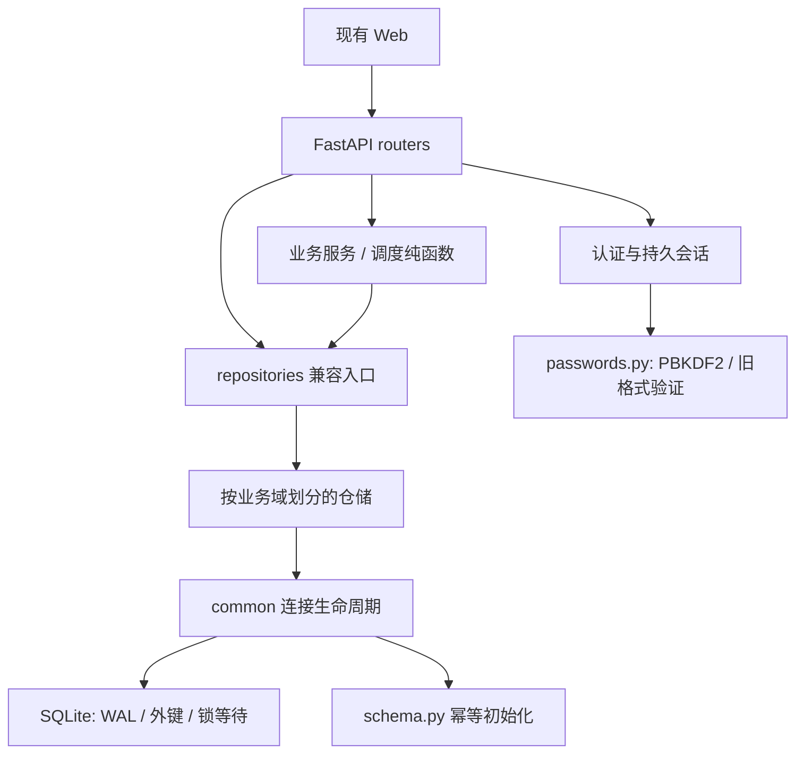

# 服务器框架与数据库基础

本轮基于 `2cf0733`，继续使用 FastAPI + SQLite；不修改公共路由、JSON字段或调度算法。目标是把现有服务整理为可维护模块，并完成密码存储升级和连接释放。

## 请求链路

## 目录职责

- `backend/main.py`：应用工厂、生命周期、路由注册和领域错误映射，调用方式不变。
- `backend/database.py`：连接参数、WAL与锁等待；配置失败立即关闭连接。
- `backend/schema.py`：从原仓储提取的表初始化与旧库兼容增量DDL，保持幂等。
- `backend/passwords.py`：盐、版本化密码编码、恒定时间验证和升级判定。
- `backend/repositories/__init__.py`：原 `backend.repositories` 导入兼容面；业务实现使用直接显式导入。
- `backend/repositories/common.py`：解析与共享辅助函数；连接使用contextmanager，在成功、异常和回滚后确定关闭。
- `users/schedule/rescue/events/microtasks/review/settings/emotion/energy/goals/team/sync.py`：领域仓储；事务整体保留在原业务操作中，不拆成各自提交的步骤。
- `errors.py`：共享异常类型，跨模块仍是同一个异常类。

机械拆分阶段的AST核对：原有函数/类没有丢失，除明确修复的 `_connect` 生命周期外，其余函数体与认证加固提交一致。原有SQL常量和偏好约束常量一起迁移。后续独立审查还补充了users中的登录失败工作量与并发注册冲突修复，均有回归覆盖。最大仓储文件384行。

## 数据模型与存储边界

| 领域 | 现有表 | 重要约束 |
|---|---|---|
| 身份与设置 | users、auth_sessions、settings | 账号唯一；会话只保存token摘要；按user_id隔离 |
| 日程与救援 | schedules、rescue_snapshots | 基线哈希、采用/撤销在原事务中完成，失败回滚 |
| 微任务与事件 | microtasks、task_events | 事件批量校验、跨用户ID冲突保留409 |
| 状态 | emotion_checkins、energy_samples | 仅真实记录，不生成演示采样 |
| 目标 | goals、goal_tasks | 任务依赖、父目标与用户归属保持原约束 |
| 团队 | team_members | 共享权限和忙碌记录沿用原契约 |
| 基础增量 | sync_changes | 仅已有游标能力；本轮不修订同步事务或实现完整队列 |

维持单实例单worker、SQLite WAL、busy_timeout=5000与已有外键策略；不切换数据库，不增删业务表，不运行生产迁移。SQL初始化仍支持此前已存在的缺列旧库，调用两次不会重复改写用户凭据。

## 密码与旧账号

新注册密码存储为 `pbkdf2_sha256$600000$<64位小写十六进制摘要>`；独立随机盐保存在原 `password_salt` 列，编码保存在原 `password_hash` 列。使用标准库hashlib、secrets与hmac，无新依赖。参数来自 [OWASP Password Storage Cheat Sheet](https://cheatsheetseries.owasp.org/cheatsheets/Password_Storage_Cheat_Sheet.html)，不等同FIPS认证。

旧单轮SHA256只用于验证，不再为新用户生成。正确密码登录后，通过旧id/盐/哈希条件更新为新格式；并发升级不会覆盖新凭据，升级后重新验证当前凭据，避免用已被并发替换的旧密码签发会话。错误密码和损坏/未知格式不会触发写入。迭代数解析有上下限，拒绝损坏值造成异常CPU消耗。

密码升级不改变用户ID、业务记录和已有会话。若升级写入失败，原凭据回滚且不会签发新token，已有会话仍有效。现代低迭代编码验证成功后可升级到当前工作因子；这是编码兼容能力，不新增降低默认参数的配置。

不存在账号、旧哈希错误、损坏哈希及低迭代哈希错误均补足当前KDF工作量，减少失败路径的账号枚举时序差异；这不是恒定端到端耗时保证。并发同账号注册由数据库唯一约束原子裁决，失败者继续返回409，不能冒泡成500。

## 发布与回滚

本轮只提交源码与测试，不连接生产服务器。首次生产发布必须完整部署backend包（包括新的repositories目录、schema.py和passwords.py），并在隔离旧库副本完成登录/救援/会话验证后，备份并原子切换完整release。

`deploy/deploy_schedule_constraints.py` 是历史单文件增量发布器，无法上传新模块。因此默认发布在SSH前明确拒绝；`--inspect` 保留历史布局只读检查能力。不要绕过保护，只上传兼容入口或移除仓储目录。新发布后应使用完整release维护工具核对布局。

密码升级后，原 `2cf0733` 不理解新编码，不能直接回滚到它。认证提交 `450ec1a` 提供了双格式读取的最低兼容基线；如需回退模块拆分，必须构建同时保留双格式验证、后续登录失败工作量和并发注册修复的兼容版本，不能直接把早期提交当作最终安全回滚包。禁止通过恢复整个旧数据库来覆盖升级后的新业务数据；正式上线前仍须具备独立备份和恢复演练。

## 后续交接

- P1：浏览器token从localStorage迁移至sessionStorage仍独立排期，本轮没有修改前端文件。
- P3：提醒与事件删除、限流/密码策略、正式域名TLS、部署SSH密钥另批实现；本轮不宣称完成这些能力。
- P4：保留测试与发布证据，验收生产环境。原Dart parity执行器已删除，本轮不运行、不伪造其通过结果。
